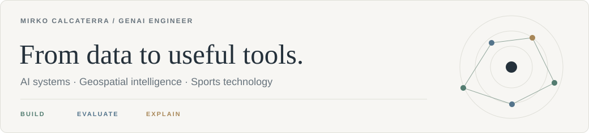
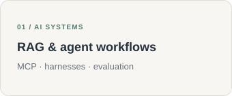
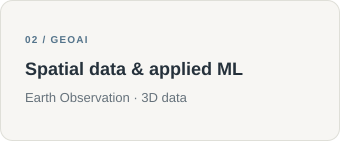
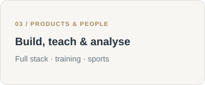
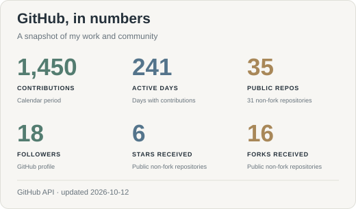
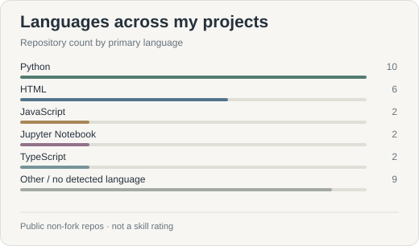
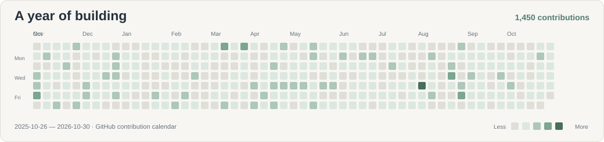

  
  
  

**AI Engineer & AI Adoption Specialist @ [Datapizza](https://datapizza.tech) · AI engineering · GeoAI · Sports tech**

I build **AI applications, data pipelines, and tools for real workflows** — from searchable knowledge bases to satellite datasets and volleyball analytics. I also design and deliver hands-on training that helps teams put AI into practice.

My background combines **Mathematical and Geoinformatics Engineering at Politecnico di Milano**. I work across Python, applied ML, and full-stack development, connecting models and data to interfaces people can use.

  
  
  

## Open something I've built

**[NASA NEO Observatory →](https://nasa-neo-rose.vercel.app/)**

Explore NASA near-Earth objects through an orbital view, charts, filters, and detail pages. **Next.js · FastAPI · ECharts** — [source & architecture](https://github.com/Rkomi98/NASA-NEO). The backend may take a little time to wake up on the first visit.

**[Quaderno: the Claude courses →](https://rkomi98.github.io/Claude-101/)**

An Italian reading experience with chapters, notes, bookmarks, and text-to-speech. An independent adaptation of public Anthropic learning materials. **JavaScript · React · GitHub Pages** — [source](https://github.com/Rkomi98/Claude-101).

**[My technical blog →](https://rkomi98.github.io/MyBlog/blog/index.html)**

Articles on AI engineering, multi-agent systems, retrieval, and geospatial data, with a bilingual Markdown publishing pipeline. **Node.js · Gemini · GitHub Pages** — [source](https://github.com/Rkomi98/MyBlog).

## More work you can inspect

| Project | What it shows |
| --- | --- |
| **[VolleyRef](https://github.com/Rkomi98/VolleyRef)** | PDF/OCR extraction → editable, validated volleyball match data → Excel/CSV. Next.js, FastAPI, OpenCV, Tesseract, and an Electron desktop package. |
| **[datapizzaAI-RAG](https://github.com/Rkomi98/datapizzaAI-RAG)** | A documentation assistant with ingestion, semantic retrieval, query rewriting, memory, and MCP integration. Python, datapizza-ai, Qdrant, Gemini, and Streamlit. |
| **[Point-cloud research](https://github.com/Rkomi98/Point-Clouds-Data-Cleaning)** | Thesis work on outliers, denoising, and vegetation removal for illegal-landfill detection, with Python experiments and synthetic data generation. |
| **[EO dataset pipeline](https://github.com/Rkomi98/PersonalProjects/tree/main/EO%20Notebook)** | Sentinel-2 discovery → cloud-aware preprocessing → Zarr/Parquet datasets, quality checks, and a PyTorch data loader. |
| **[DevPath](https://github.com/Rkomi98/DevPath)** | An adaptive coding-practice MVP: diagnostic onboarding, progressive hints, and isolated Python execution. Next.js, PostgreSQL/Supabase, and Docker. |
| **[Blender workflow plugin](https://github.com/Rkomi98/senior-blender-designer-plugin)** | AI-assisted 3D production with modelling, UVs, rendering, visual review, and Python checks for geometry, printability, and export. |

## Experience beyond the public repos

My private projects also cover:

- **Agent engineering:** MCP tools/resources, harness design, skills, deterministic controls, human approval gates, and regression checks.
- **Evaluation & platforms:** retrieval and generation evaluation, asynchronous scoring, queues, event administration, and role-based access.
- **Analytics & reporting:** configurable survey pipelines, clustering, LLM-assisted text analysis, traceable artefacts, and automated reports.
- **Sports products:** touchscreen scouting, rotations and libero logic, video-analysis workflows, and prototypes for automated clip generation.
- **Applied ML:** 3D segmentation, thermal-image processing, and comparisons between CNN baselines and foundation-model approaches.
- **Integrations:** OAuth, PostgreSQL/Supabase, Redis/RQ, Google Apps Script, Drive, and calendar workflows.

This work informs my skills; client information, datasets, and private code stay private.

## Tools I reach for

**AI & agents**

Retrieval, agent orchestration and evaluation · pandas & scikit-learn · OpenAI, Gemini & Anthropic.

**Applications & infrastructure**

React interfaces · REST APIs & OAuth · Redis/RQ · GitHub Actions.

**Geospatial & visual computing**

Earth Observation · xarray & Zarr · 3D point clouds · Plotly & Streamlit.

## GitHub at a glance

  
  

Source: GitHub · Updated daily · Repository metrics cover public work; the language chart counts non-fork repositories.

I enjoy the full path from **understanding a problem to building, evaluating, and explaining a solution**. Outside work, you'll often find me on a volleyball court.

[Browse all public projects](PROJECTS.md) · [Let's connect](https://www.linkedin.com/in/mirko-calcaterra-30029519b)

Updated 10 October 2026 · Public examples, plus a capability summary of private work.
